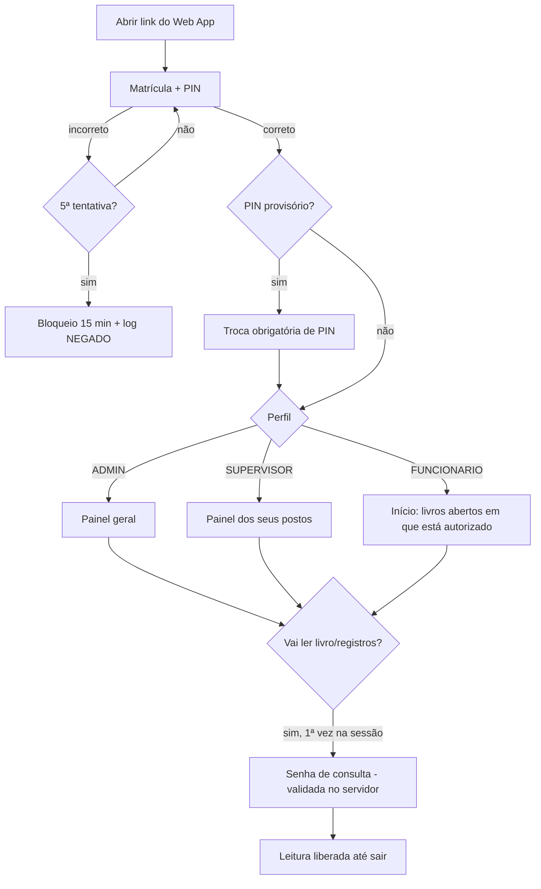
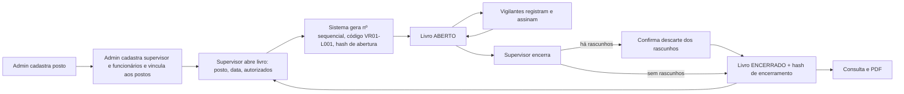
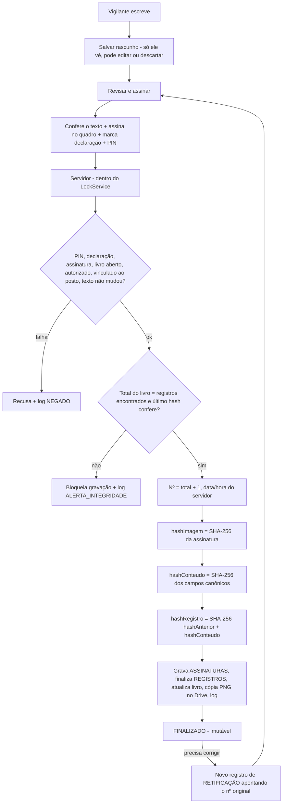
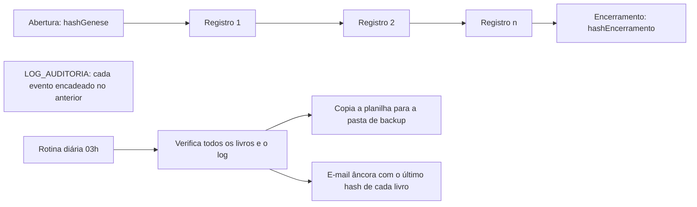

# Livro ATA Digital — Fluxograma e matriz de permissões

Documento de referência obrigatório: qualquer mudança no sistema deve ser conferida aqui antes de ser implementada.

## 1. Acesso

Sessão: 30 min de inatividade ou 12 h no máximo. Desativar um acesso derruba a sessão na próxima ação.

## 2. Ciclo do livro

Regra: um posto só pode ter **um livro aberto** por vez. Encerrado nunca reabre.

## 3. Registro e assinatura (função crítica)

Retificação: só do próprio registro, sempre no livro aberto do mesmo posto (pode apontar para livro anterior já encerrado). O original nunca muda; ele passa a mostrar "Retificado pelo registro nº X".

## 4. Integridade

Qualquer edição manual na planilha quebra a cadeia e aparece em "Verificar integridade", no PDF e no e-mail diário.

## 5. Matriz de permissões (aplicada no servidor, em Api.gs)

| Ação | Admin | Supervisor | Vigilante |
|---|---|---|---|
| Cadastrar/editar postos | ✔ | — | — |
| Cadastrar supervisores, funcionários, admins | ✔ | — | — |
| Redefinir PIN, desativar, desbloquear | ✔ | — | — |
| Ver equipe | todos | dos seus postos | — |
| Abrir livro / alterar autorizados / encerrar | — | seus postos | — |
| Ler livro (com senha de consulta) | todos | seus postos | postos vinculados |
| Escrever, rascunho, assinar | — | — | livros abertos em que é autorizado |
| Retificar | — | — | só os próprios registros |
| Quem assinou / verificar livro / PDF | ✔ | seus postos | — |
| Buscar registros | todos | seus postos | só os próprios |
| Verificação geral, auditoria, senha de consulta | ✔ | — | — |
| Editar ou excluir registro assinado | ninguém | ninguém | ninguém |

## 6. Banco de dados (Google Sheets, todas as colunas em texto)

USUARIOS · FUNCIONARIOS · SUPERVISORES · POSTOS · LIVROS_ATA · REGISTROS · ASSINATURAS · RETIFICACOES · LOG_AUDITORIA

Relações: USUARIOS.refId → FUNCIONARIOS.id / SUPERVISORES.id · FUNCIONARIOS.postoIds / SUPERVISORES.postoIds → POSTOS.id · LIVROS_ATA.postoId → POSTOS.id · REGISTROS.livroId → LIVROS_ATA.id · ASSINATURAS.registroId → REGISTROS.id · RETIFICACOES liga registro original ↔ retificação.

ASSINATURAS, RETIFICACOES e LOG_AUDITORIA são somente inclusão (a camada de dados recusa update). REGISTROS FINALIZADO é recusado na camada de dados, não só na tela.
